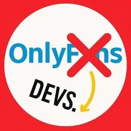
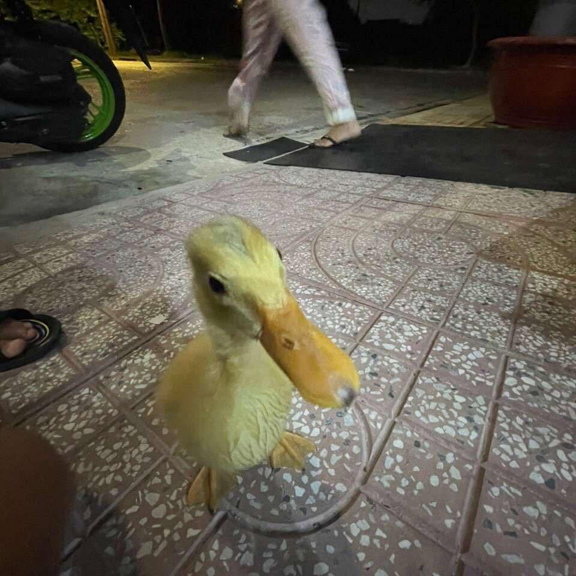

<!-- markdownlint-disable MD033 MD041 -->

<div align="center">


<br />


</div>

---

### `whoami`

```text
KhoaHihi @ Reverse Engineering
├── Founder   : OnlyDevs.online — community for devs who dig deeper
├── Focus     : native code, game / mobile protections, protocol & binary logic
├── Mindset   : read assembly like prose, prove claims with evidence
└── Stack     : Windows / Android / IL2CPP / ARM & x86_64
```

**Reverse engineer** — tôi đào sâu vào binary, hook runtime, và gỡ lớp bảo vệ để hiểu *thực sự* hệ thống đang làm gì, không chỉ đoán từ surface API.

---

### `onlydevs` — founder

<table>
<tr>
<td width="120" align="center">
  
  <br />
  
</td>
<td>

**Founder** của [**OnlyDevs**](https://onlydevs.online/) — nơi dev thích reverse, low-level, và build thứ *thật sự chạy được* gặp nhau (không phải OnlyFans, chỉ **Devs**).

- 🌐 Website: **[onlydevs.online](https://onlydevs.online/)**
- 💬 Discord: **[discord.gg/kEdMcjnftp](https://discord.gg/kEdMcjnftp)**
- 📦 Source (private): [**OnlyDEVS-Antigravity**](https://github.com/Khoahihi1/OnlyDEVS-Antigravity)

</td>
</tr>
</table>

<p align="center">
  <a href="https://onlydevs.online/">
    
  </a>
  <a href="https://discord.gg/kEdMcjnftp">
    
  </a>
</p>

---

### `toolchain`

<p align="center">
  
  
  
  
  
  
</p>

<p align="center">
  
  
  
  
  
  
</p>

---

### `domains`

| Area | What I do |
|------|-----------|
| **Static analysis** | CFG recovery, type recovery, xref hunting, signature building |
| **Dynamic analysis** | breakpoints, trace, hook (Frida / Zygisk), dump at runtime |
| **Protections** | obfuscation, anti-debug, packing, integrity checks |
| **Deliverables** | maps, dumpers, patches, internal docs, reproducible PoC |

---

### `highlights`

- Reverse native & **IL2CPP** targets — runtime dump, metadata, script glue
- Comfortable in **WinDbg / x64dbg** triage and long debug sessions
- **IDA** + **Ghidra** workflow: decompile ↔ disasm ↔ patches ↔ notes in-repo
- Android root / **Zygisk** modules when userspace hook is not enough

---

### `stats`

<div align="center">


<br />


</div>

---

### `repos`

Pinned work: chủ yếu trên [**OnlyDEVS-Antigravity**](https://github.com/Khoahihi1/OnlyDEVS-Antigravity) và [**BrMod**](https://github.com/Khoahihi1/BrMod) — cứ pin repo bạn muốn showcase trên GitHub Settings → Profile.

---

### `connect`

<p align="center">
  <a href="https://onlydevs.online/">
    
  </a>
  <a href="https://discord.gg/kEdMcjnftp">
    
  </a>
  <a href="https://github.com/Khoahihi1">
    
  </a>
</p>

<p align="center">
  
</p>

---

<div align="center">

```asm
; if you can read this, we should talk
mov     rcx, offset binary
call    reverse_engineer
```


</div>